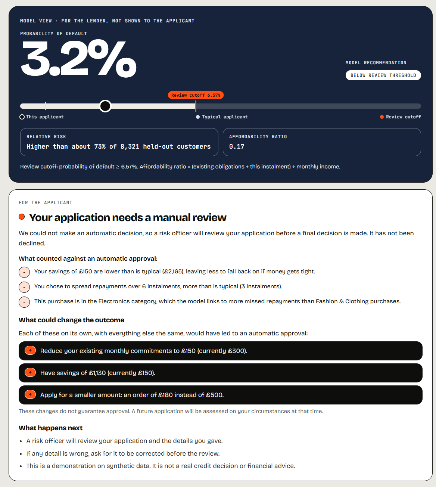
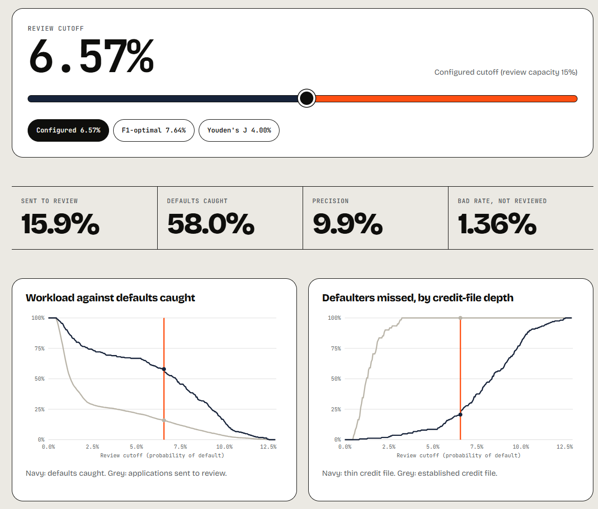
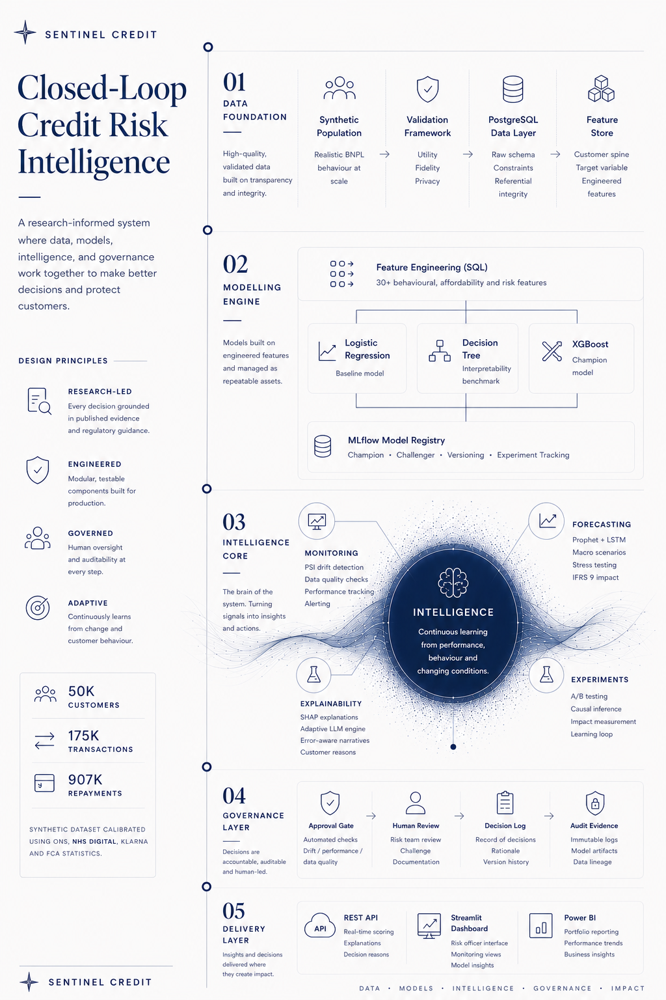

# Sentinel Credit

**A credit risk platform for Buy Now, Pay Later (BNPL) lending, built end to end on a synthetic portfolio I generated: 50,000 simulated customers, no real customer data.** It connects data, explainability, monitoring and governance into one closed loop, informed by published UK research and regulation.

**[▶ Try the live demo](https://korede-folarin.github.io/sentinel-credit/)** · [Read the case study](https://koredefolarin.com/sentinel-credit.html) · [Engineering Decision Log](docs/engineering_decision_log.md) · [Model results](docs/model_results_summary.md)

[](https://github.com/korede-folarin/sentinel-credit/actions/workflows/ci.yml)    

---

## In 30 seconds

- **What it is:** an end-to-end credit risk platform for BNPL lending, built on synthetic data. It covers data generation and validation, a feature store, model training and promotion, explanations, drift monitoring and audit evidence, all wired into one loop.
- **What you can do right now:** [score an application in your browser](https://korede-folarin.github.io/sentinel-credit/). The governed champion model runs on the page and nothing you type leaves it. You get the decision an applicant would see, in plain English, and what would change it.
- **Why it's different:** every consequential choice is written up with its evidence in an **[Engineering Decision Log](docs/engineering_decision_log.md)** of 35 decisions. That includes the mistakes I found in my own work and how I fixed them.
- **Headline result:** on the synthetic portfolio, a calibrated XGBoost with **Gini 0.56** that holds out of time (0.5618 → 0.5611). The browser copy of the model was checked against the Python original on **41,604 customers with zero decisions changed**.
- **v2, in progress: judgement under evidence.** I tested a PyTorch challenger, live streaming features (Kafka, PyFlink) and Spark at 2 million customers. The challenger lost and was not promoted; the streaming target was missed and reported as missed; Spark lost to PostgreSQL and was not recommended. See [v2](#v2-extending-the-platform-without-touching-v1).

---

## See it working

<p align="center">
  
</p>

**Above:** one assessment. The lender sees the probability of default against the 6.57% review cutoff. The applicant sees a plain-English outcome, the reasons in their own figures, and model-tested changes that would alter it. They never see the score or the model's internals.

<p align="center">
  
</p>

**Above:** the [cutoff and fairness simulator](https://korede-folarin.github.io/sentinel-credit/simulator.html). Move the cutoff and watch the workload, the defaults caught, and *who bears the errors* change, using the champion's real held-out results.

---

## Results

Champion **v1.1**: XGBoost, Platt-calibrated, 13 features. Trained on 33,283 customers, tested on 8,321 held out, plus an out-of-time split. Full detail: [Model Results Summary](docs/model_results_summary.md).

| Held-out | Stratified | Out-of-time |
|---|---:|---:|
| Gini | **0.5618** | **0.5611** |
| AUC | 0.7809 | 0.7806 |
| KS | 0.4712 | 0.4390 |
| Brier score | 0.0254 | 0.0241 |
| Defaults caught at the cutoff (recall) | 57.96% | 40.32% |
| Applications sent to review | 15.9% | 11.9% |
| Precision at the cutoff | 9.90% | 8.65% |

- **How the cutoff was set:** a probability of default of 0.0657 or more sends an application to manual review. It was set on the training data (out-of-fold predictions) so that 15% of applications go to review, the workload of an assumed review team. On held-out data that becomes 15.9%, and 11.9% out of time. This synthetic lender has no loss or review-cost figures to price errors on, so the cutoff is tied to workload, and the 15% is itself a stated assumption (see *Honest limitations*). Where error costs can be estimated, pricing the threshold on them is the stronger method.
- **Three models were benchmarked:** XGBoost (Gini 0.5618) against a decision tree (0.5486) and logistic regression (0.4896).
- **The riskiest 10% of customers hold 39% of all defaults** (lift 3.93×).

---

## The decisions I'm proudest of

Accuracy is the easy part. These are the judgement calls a model risk reviewer would ask about. Each links to its write-up.

1. **I removed a strong feature because it leaked the answer.**
   - `pct_late_payments` partly encoded the outcome: "late" also recorded arrears pay-offs, and post-default rows sat in its denominator.
   - Removing it cost 0.004 Gini, with a 95% confidence interval that includes zero.
   - The promotion rule only allowed a new champion that beat the old one on Gini, so a fix like this could never pass. I added a validity override, with evidence, instead of bending the numbers. *(Decisions 26–27)*
2. **I found the model's blind spot and routed it to a person.**
   - Customers with an established credit file *never* reach the review cutoff, so at the cutoff the model misses every defaulter in that group.
   - Within the group it still ranks risk: the top 5% default about **three times as often** (31 against 11 per 1,000 on held-out data).
   - Those applicants now get "risk officer review required", stated rather than silently passed. *(Decision 31)*
3. **I don't trust a converted model: I prove it.**
   - The public demo runs an ONNX copy of the champion in the browser.
   - Before every deploy, 25 automated browser checks confirm three things: it scores like Python (max difference 6e-8 across 41,604 customers, 0 flips), the explanations match the Python service word for word, and no request leaves the site. *(Decision 29)*
4. **Explanations are for the person reading them.**
   - The applicant gets an outcome (approved, declined over the 45% affordability limit, or manual review), reasons in their own figures, and changes the model has actually tested.
   - The risk officer gets risk factors, strengths and checks in plain language.
   - The decision rule is deliberately hidden from applicants. FCA research (Belton et al., 2025) found that showing it cut error-spotting by 18 points. *(Decisions 30–35)*
5. **Synthetic data, validated before use.**
   - No public UK BNPL dataset exists, so I generated 50,000 customers, 174,000 transactions and 484,000 repayments.
   - Default is *emergent*: it comes from repayment behaviour and reaches the 90-days-past-due definition, rather than being stamped on in advance.
   - The data passes the FCA / ICO / Alan Turing Institute fidelity, utility and privacy checks. *(Decisions 1, 2, 10)*
6. **I audit my own documentation.** In October 2026 I checked every claim in the docs against the code. I logged what was wrong, fixed it and kept the record: [Audit Findings](docs/audit_findings_2026-10-12.md).

---

## How it works



```text
Synthetic data ─► Validation ─► PostgreSQL feature store ─► Train & calibrate (MLflow)
      ▲                                                            │
      │                                              Champion / challenger + evidence gate
      │                                                            │
 Drift monitoring (Airflow, PSI) ◄── Scoring: FastAPI · Streamlit · in-browser ONNX
                                                                   │
                                   Explanations: applicant · risk officer · decision record
```

| Layer | Built with |
|---|---|
| Data and features | Python · PostgreSQL (constrained raw schema, 64-column feature store) |
| Modelling | scikit-learn · XGBoost · SHAP · Prophet (portfolio forecasting) |
| MLOps | MLflow tracking and Model Registry · Apache Airflow (Astro, Docker) · evidence-gated promotion |
| Serving | FastAPI · Streamlit dashboard · Power BI (DirectQuery) · ONNX Runtime Web (public demo) |
| Quality | pytest suite and CI on every push · headless-browser deploy gate (GitHub Actions) · parity checks · word-for-word explanation tests |
| v2 extensions | PyTorch · Kafka · Apache Flink (PyFlink) · Apache Spark · Docker |

---

## v2: extending the platform without touching v1

v2 asks the questions a lender would ask next: would a neural network do better, can the features be computed live, and what happens at millions of customers? The interesting part is not the tools. It is what I decided when the evidence came back, including the three times it said "no". Each call is written up in the [v2 Engineering Decision Log](docs/v2_engineering_decision_log.md), failed runs included.

### The judgement calls

1. **I protected v1 before building anything on it.**
   - It is easy to say "v2 changes nothing in v1" and hard to prove it. So before any v2 code, v1 was frozen at Git tag `v1.0-evaluated` and fingerprinted: hashes of its model files, feature definitions and code, the database's row counts and columns, and all 103 MLflow runs. CI checks the committed part on every push; the full check runs locally and passes.
   - v2 writes only to its own schemas and MLflow experiments. The API, dashboard and Power BI still read v1. The one approved change to v1 code lets the API load its model from a chosen folder, for containers; when that setting is not used, it behaves exactly as before. *(V2-01)*
2. **The PyTorch challenger lost, so XGBoost stays champion.**
   - The challenger passed the Approval Gate's integrity checks. Passing the gate is not the same as winning.
   - On the stratified test it was clearly worse (Gini 0.5329 against 0.5618, 95% CI excluding zero). Out of time it was slightly better (0.5700 against 0.5611), but that CI includes zero, so it is noise, not a win.
   - It also misses every defaulter with an established credit file, exactly like the champion. A more complex model does not fix a problem that sits in the data. *(V2-02)*
3. **I changed the streaming design when the measurements said so, and kept the target I missed in the write-up.**
   - My first design (a timer per event) capped out at about 340 events/s. Processing each event on arrival reached 436/s on the same test, so the design changed. Settings that favour latency cost throughput, so I kept the throughput settings and wrote down why.
   - The goal was 1,000 events/s. The laptop sustained about 360/s. That is reported as **not achieved**, with the scaling path marked designed only, rather than quietly lowering the target.
   - Streaming scores run in **shadow mode**: they are recorded and compared, never used to decide. A new scoring path earns decision rights only after it is validated. *(V2-03)*
4. **For Spark, I required exactness before I timed anything, and then reported that Spark lost.**
   - Fast but slightly different features would quietly change credit decisions. So every engine had to reproduce v1's feature store exactly (0 values different) before its timings counted.
   - At 2 million customers, PostgreSQL (the tool v1 already used) was fastest. Spark scaled best but did not pay off on one machine. The honest recommendation is not to adopt Spark at this size, and I did not claim a crossover point I never measured.
   - I deliberately did **not** retrain on the scaled data. A new dataset needs its features and cutoff re-derived, so that is its own piece of work, not a side effect. *(V2-04)*
5. **I priced the cloud deployment before building it, and paused it on cost.**
   - Deploying the API to AWS was designed with a tear-down the same day, and access restricted to one IP. It was priced from AWS's published rates at about $0.08 an hour.
   - It is paused until there is budget, and labelled designed only, not deployed.

### Results so far

All v2 data is synthetic or a simulated replay, and every number comes from a real run.

| Step | What was done | Real result | Status |
|---|---|---|---|
| **V2-01**: protect v1 | v1 fingerprint check, a test suite, CI on every push, the scoring API packaged as a Docker image | 71 tests pass locally (59 run on CI, the rest need the local database or Docker); v1 verified unchanged | Running |
| **V2-02**: PyTorch challenger | A neural network trained on the champion's 13 features and splits, put through the Approval Gate. Plus an autoencoder for unusual applicants | Challenger Gini 0.5329 against the champion's 0.5618 (worse, 95% CI excludes zero); out of time 0.5700 against 0.5611 (CI includes zero). **Not promoted: XGBoost stays champion.** The autoencoder is not a default signal (AUC 0.46) | Tested locally |
| **V2-03**: streaming features (shadow mode) | Kafka and PyFlink rebuild features from a simulated event stream, with duplicate and late events, and score applications as they arrive. Scores are recorded, no decisions made | Features matched the v1 feature store for 50,000 of 50,000 customers; no decision differed. Kept up at 10 and 100 events/s (median latency 3.1 s and 4.3 s). At a 1,000 events/s target it sustained about 360/s, so 1,000/s was **not achieved** on one laptop. Recovered from killed workers with no loss or double counting | Tested locally |
| **V2-04**: feature store at scale | The feature store rebuilt with PostgreSQL, pandas and Spark at 50k, 250k, 1M and 2M synthetic customers | Every engine matched exactly (0 of 126 million values different at 2M). At 2M: PostgreSQL 211 s, pandas 302 s, Spark 354 s. **Spark did not pay off by 2M customers on one machine**, though it scaled best | Tested locally |
| **Phase 3**: AWS | The scoring API on ECS Fargate in London, behind a load balancer, deployed, tested and torn down the same day | Planned and priced at about $0.08 an hour from AWS's published prices; paused, nothing built | Designed only |

---

## Run it yourself

```bash
python data_generator/bnpl_data_generator.py          # generate the synthetic data
python validation/validation.py                       # fidelity, utility and privacy checks
psql -U postgres -d sentinel_credit -f sql/01_create_schema.sql
uvicorn serving.app:app --reload                      # scoring API
streamlit run dashboard/Home.py                       # risk officer dashboard
```

- **Settings:** everything is configured in `config.yaml`.
- **Database password:** set `SENTINEL_DB_PASSWORD` in the environment. It is never written into code.
- **Shared scoring:** the API, the dashboard and the demo site share one scoring path (`serving/features.py`, `serving/reasons.py`), so they give identical answers.
- **Tests:** `pytest` (71 tests; 59 run on CI, the rest need the local database or Docker). What is and isn't covered, honestly: [TESTING.md](TESTING.md).
- **No database?** The Streamlit dashboard also runs from a published snapshot: see *Public Streamlit demo* below.

<details>
<summary><b>Repository map</b></summary>

| Folder | What's in it |
|---|---|
| `data_generator/` | Hazard-based synthetic BNPL data generator |
| `validation/` | Synthetic-data fidelity, utility and privacy checks |
| `sql/` | Raw schema, feature store, reporting views |
| `models/` | Training, evaluation, SHAP, cutoff selection, explanation rules |
| `pipeline/` | Drift monitoring, approval gate, champion promotion (Airflow DAGs) |
| `serving/` | FastAPI scoring service, shared features and explanations |
| `dashboard/` | Streamlit risk officer dashboard, Power BI setup |
| `forecasting/` | Prophet portfolio forecasts |
| `website/` | Public demo site, its export tools and browser checks |
| `docs/` | Decision logs (v1 and v2), results, audit findings, design and references |
| `tests/` | pytest suite, run by CI on every push |
| `infra/` | Airflow (Astro) project and DAGs |
| `v2/` | v2 work: challenger, streaming, Spark at scale, Docker image, v1 fingerprint |

</details>

<details>
<summary><b>Implementation status</b> (October 2026, checked against the code)</summary>

✅ built and verified · 🟡 partly built · ⬜ planned. "D" numbers refer to the [Engineering Decision Log](docs/engineering_decision_log.md).

| Component | What exists | Status |
|---|---|---|
| Synthetic data generator | 50k customers · 174k transactions · 484k repayments · hazard-based, emergent default (D1, D10) | ✅ |
| Validation module | Fidelity 8/8 · Utility PASS · Privacy 2/2 (D2). CTGAN benchmark planned | ✅ |
| Database and feature store | Local PostgreSQL, constrained raw schema, 64-column feature store (D3, D12, D17) | ✅ |
| Three-model benchmarking | Logistic regression · decision tree · XGBoost, calibrated, MLflow-tracked (D4, D13) | ✅ |
| Champion model | **v1.1**: XGBoost, 13 features, cutoff 0.0657 (D18, D19, D27) | ✅ |
| Explainability (SHAP) | Global and local SHAP on the champion (D14) | ✅ |
| A/B test analysis | Two-proportion test, power analysis, covariate balance (D15, D16) | ✅ |
| Champion / challenger workflow | MLflow Model Registry aliases, validity-override path, rollback rule (D21, D27) | ✅ |
| Drift monitoring | PSI + data quality, origination-cohort view; Airflow, runs while the local stack is up (D20, D24, D25) | ✅ |
| Approval gate | Automated evidence gate on promotion + typed human confirmation; no approver identity recorded (D23) | 🟡 |
| Portfolio forecasting | Prophet, backtested. LSTM and IFRS 9 macro scenarios planned (D22) | 🟡 |
| Scoring API | FastAPI, runs locally (`serving/app.py`) | ✅ |
| Streamlit dashboard | Risk officer interface; public demo mode from a published snapshot (D32) | ✅ |
| Power BI report | DirectQuery against local PostgreSQL (`dashboard/powerbi/`) | ✅ |
| Plain-English reasons | Outcome (approved, declined over the 45% affordability limit, or manual review), reasons in the applicant's own figures, repayment plan, model-tested changes (D30, D31, D33–D35) | ✅ |
| Adaptive explanation engine | Error-type checks, "risk officer review required" flag; applicant, risk officer and audit-record outputs (D7, D31). Approver identity not recorded (D23) | ✅ |
| Public demo site | In-browser ONNX champion on GitHub Pages, gated on 25 browser checks (D29–D31) | ✅ |
| Container image | The scoring API as a Docker image, built and smoke-tested locally (V2-01) | ✅ |
| Cloud deployment / AWS | ECS Fargate deployment planned and priced, not built. The API, database and dashboard run locally (D3, D6) | ⬜ |
| v2 extensions | PyTorch challenger, PyFlink streaming, Spark at scale: see [v2](#v2-extending-the-platform-without-touching-v1) | ✅ tested locally |

</details>

<details>
<summary><b>Public Streamlit demo</b></summary>

The dashboard has a demo mode for Streamlit Community Cloud (Decision 32):
- **What it reads:** a published snapshot in `dashboard/demo_data/` (aggregate query results, aggregate reports and the model files). It never needs a database.
- **What's live:** new-applicant scoring.
- **What stays local:** existing-customer lookup and per-customer case studies, because customer records are never published.

To deploy it once:
1. At [share.streamlit.io](https://share.streamlit.io), choose **Create app**.
2. Pick this repository, branch `main`, main file `dashboard/Home.py`.
3. Under **Advanced settings**, choose Python 3.11 and add the secret `SENTINEL_DEMO = "1"`.

Every push to `main` then redeploys it. Refresh the snapshot after a promotion or report run with `python dashboard/tools/export_demo_data.py`.

</details>

---

## Honest limitations

A model is only as trustworthy as what it admits about itself:

- **All data is synthetic.** It is calibrated to published UK evidence, but it is not real lending data.
- **The champion is a customer-level portfolio-risk model,** not a validated application-time underwriting model. The demo's approvals illustrate the mechanism (Decision 18).
- **The 15% review capacity behind the cutoff is a placeholder.** It's an assumption awaiting a business owner.
- **The model leans on order size in ways a lender should question.** For 71 held-out customers, small orders alone keep them below the review line. This is flagged for the next model review (audit findings A31, A35).
- **Approver identity is not yet recorded** in promotion or decision records (Decision 23).
- **The platform runs locally.** Only the demo site and the dashboard snapshot are public.
- **v2's streaming and scale results come from one laptop,** a simulated replay and synthetic data. They show the design works and where it stops, not production throughput.

---

## Documentation

| Document | Purpose |
|---|---|
| [Engineering Decision Log](docs/engineering_decision_log.md) | Every consequential v1 decision, its evidence and its outcome |
| [v2 Engineering Decision Log](docs/v2_engineering_decision_log.md) | v2 decisions V2-01 to V2-04, with real run results and failed runs |
| [Model Results Summary](docs/model_results_summary.md) | One-page results for the champion |
| [Project Rationale](docs/project_rationale.md) | Why the project exists, plus its research and regulatory foundations |
| [Database Design](docs/database_design.md) | Schema, integrity constraints, feature engineering |
| [Validation Results](docs/validation_results.md) | Synthetic-data validation results and method |
| [Model Evaluation Report](docs/model_evaluation_report.md) | Evaluation results and metric definitions |
| [Forecasting Summary](docs/forecasting_summary.md) | Prophet portfolio forecasts, backtests and caveats |
| [Audit Findings](docs/audit_findings_2026-10-12.md) | My audit of the documentation against the code |
| [Power BI Setup](dashboard/powerbi/README.md) | Connecting the Power BI report to the reporting views |
| [References](docs/references.md) | Regulatory publications, research and calibration sources |

**Research foundation:**
- FCA Credit Rating Agencies Multi-Firm Review (2026)
- Belton et al., FCA AI Explainability Research Note (2025)
- FCA / ICO / Alan Turing Institute Synthetic Data Framework (2023)
- PRA SS1/23 Model Risk Management
- CRR/EBA default definition and IFRS 9

---

## About

Built by **Korede Folarin**: [portfolio](https://koredefolarin.com/) · [the Sentinel Credit case study](https://koredefolarin.com/sentinel-credit.html).

<sub>**Disclaimer.** Sentinel Credit is an independent portfolio project informed by publicly available research and regulatory publications. References to the FCA, PRA, ICO, Alan Turing Institute and other organisations indicate publications that informed engineering decisions. They do not imply regulatory approval, certification, endorsement or affiliation.</sub>
