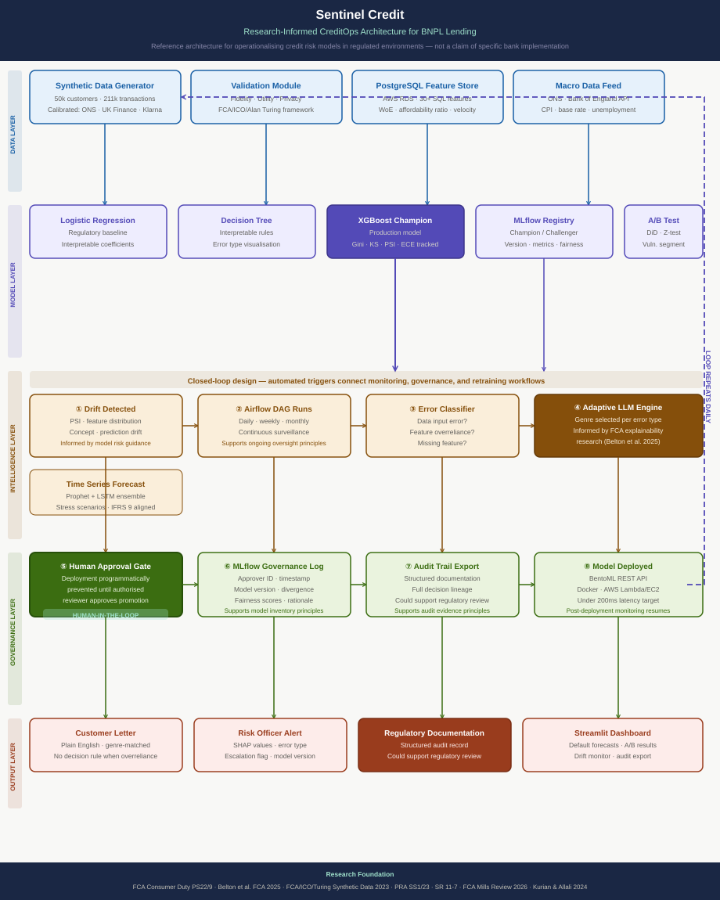

# Sentinel Credit
## Research-Informed Credit Risk Intelligence Architecture for BNPL Lending

This project explores how monitoring, explainability, governance, and audit evidence
can be connected into a closed-loop machine learning workflow for regulated lending
environments.

Every design decision traces to a published research finding or regulatory document.
See the [Engineering Decision Log](docs/engineering_decision_log.md).

---

## Architecture



---

## Motivation

Reading FCA publications on model governance and AI explainability in financial
services raised a practical engineering question:

*If continuous monitoring, governance, documentation, and oversight are all
necessary — what does a system that connects them automatically look like?*

BNPL was chosen as the application context because it commonly serves customers
with limited traditional credit histories, making model governance, explainability,
and fairness particularly important.

Synthetic data was chosen because no widely available public dataset was identified
that adequately represents UK BNPL customer behaviour. Generating synthetic data
introduced its own challenges around privacy, fidelity, and utility — requiring a
structured validation approach informed by published guidance.

---

## Three Research Problems This Project Addresses

**Problem 1 — Governance tools are disconnected**

The FCA Credit Rating Agencies multi-firm review (May 2026) highlights that
governance weaknesses can persist even where firms have sophisticated tooling,
particularly when monitoring, governance, and audit activities are insufficiently
integrated.

**Problem 2 — Explainability is applied uniformly**

The FCA AI explainability research note (Belton et al., February 2025) found that
providing more detailed explanations decreased participants' ability to identify
model errors by up to 20 percentage points. These findings suggest that explanation
approaches may need to be tailored to the error type and intended audience rather
than applied uniformly.

**Problem 3 — No validated synthetic data exists for UK BNPL**

No widely available public dataset was identified that adequately represents UK
BNPL customer behaviour. This project generates and validates synthetic data using
the three-dimension framework defined by the FCA, ICO, and Alan Turing Institute
— utility, fidelity, and privacy.

---

## Platform Components

| Component | Description | Status |
|---|---|---|
| Synthetic data generator | 50k customers · 211k transactions · 894k repayments | ✅ Complete |
| Validation module | Fidelity · utility · privacy per FCA/ICO/Turing framework | 🔄 In progress |
| PostgreSQL feature store | 30+ SQL-engineered features on AWS RDS | 🔄 In progress |
| Three-model comparison | Logistic regression · decision tree · XGBoost | 🔄 In progress |
| A/B testing and causal inference | Z-test · chi-squared · difference-in-differences | 🔄 In progress |
| Drift monitoring | PSI-based Airflow surveillance DAG | 🔄 In progress |
| Adaptive explanation engine | Error-type-aware LLM explanation layer | 🔄 In progress |
| Governance and approval workflow | MLflow champion/challenger · human approval gate | 🔄 In progress |
| Time series forecasting | Prophet · LSTM · stress scenarios · IFRS 9 aligned | 🔄 In progress |
| Streamlit dashboard | Risk officer interface · audit export | 🔄 In progress |
| Deployment infrastructure | S3 · RDS · EC2/Lambda · CI/CD | 🔄 In progress |
| Power BI dashboard | Portfolio, model performance, and risk profile views | 🔄 In progress |

---

## Research Foundation

| Publication | How It Shaped The Design |
|---|---|
| FCA CRA Multi-Firm Review, May 2026 | Governance integration failures — motivated closed-loop architecture |
| Belton et al., FCA Research Note, February 2025 | Explanation genre affects outcomes — motivated adaptive explanation engine |
| FCA/ICO/Alan Turing Institute, June 2023 | Validation framework for utility, fidelity, and privacy |
| PRA SS1/23, April 2023 | Model risk management principles informing governance layer |
| Kurian and Allali, 2024 | PSI thresholds for drift detection — 0.10 and 0.25 |
| Demajo et al., 2020 | XGBoost on credit scoring · multi-audience explainability |
| Khalili et al., 2026 | BNPL thin-file customer characteristics |
| Kurshan et al., 2020 — JP Morgan AI Research | AI governance challenges · self-regulating framework |
| Brahmandam, 2025 | MLOps automation in financial services |
| Kiran and Saravana Kumar, 2024 | Synthetic data generator evaluation methodology |

Full reasoning: [Engineering Decision Log](docs/engineering_decision_log.md)

---

## Closed Loop — Eight Steps

```
① Drift detected     — PSI breach triggers Airflow
② Airflow DAG runs   — daily, weekly, monthly cadence
③ Error classifier   — data input / overreliance / missing feature
④ Adaptive LLM       — audience-specific explanations generated
⑤ Human gate         — deployment blocked until authorised sign-off
⑥ MLflow log         — approver, timestamp, version recorded
⑦ Audit export       — structured documentation for review
⑧ Model deployed     — BentoML REST API, Docker, AWS
         ↓
Loop repeats daily → back to ①
```

Steps 1 to 4 automated. Step 5 mandatory human-in-the-loop.
Steps 6 to 8 complete automatically after approval.

---

## Stack

```
Data          Python · PostgreSQL · AWS S3 · AWS RDS
Modelling     Scikit-learn · XGBoost · SHAP · MLflow
Pipeline      Apache Airflow · GitHub Actions
Serving       BentoML · Docker · AWS Lambda/EC2
Dashboard     Streamlit · Plotly
LLM           Anthropic Claude API
Dashboard     Streamlit · Plotly · Power BI
```

---

## File Structure

```
Sentinel_Credit/
├── data_generator/          # Synthetic BNPL data generator
│   └── output/              # Generated CSV files
├── validation/              # Synthetic data validation module
│   └── reports/             # Validation output reports
├── sql/                     # PostgreSQL feature engineering
├── models/                  # Model training and comparison
├── explainability/          # Adaptive explanation engine
│   └── prompts/             # LLM prompt templates
├── pipeline/                # Airflow DAGs
│   └── dags/
├── forecasting/             # Time series models
├── serving/                 # BentoML API and approval gate
├── dashboard/               # Streamlit risk officer interface
│   └── pages/
├── infra/                   # AWS infrastructure
│   └── terraform/
├── docs/                    # Architecture diagram and decision log
│   └── engineering_decision_log.md
├── tests/                   # Test suite
├── config.yaml              # Centralised configuration
└── requirements.txt         # Dependencies
```

---

## Project Status

Active development. Core architecture defined and implementation in progress.

Follow the build on LinkedIn:
[Folarin Korede](https://www.linkedin.com/in/folarinkorede)

---

## Important Note

This project is a personal portfolio exploration informed by publicly available
research and regulatory publications. It is not affiliated with any financial
institution. Regulatory publications are referenced as research inputs that
informed design decisions and should not be interpreted as evidence of regulatory
approval, certification, or compliance.
