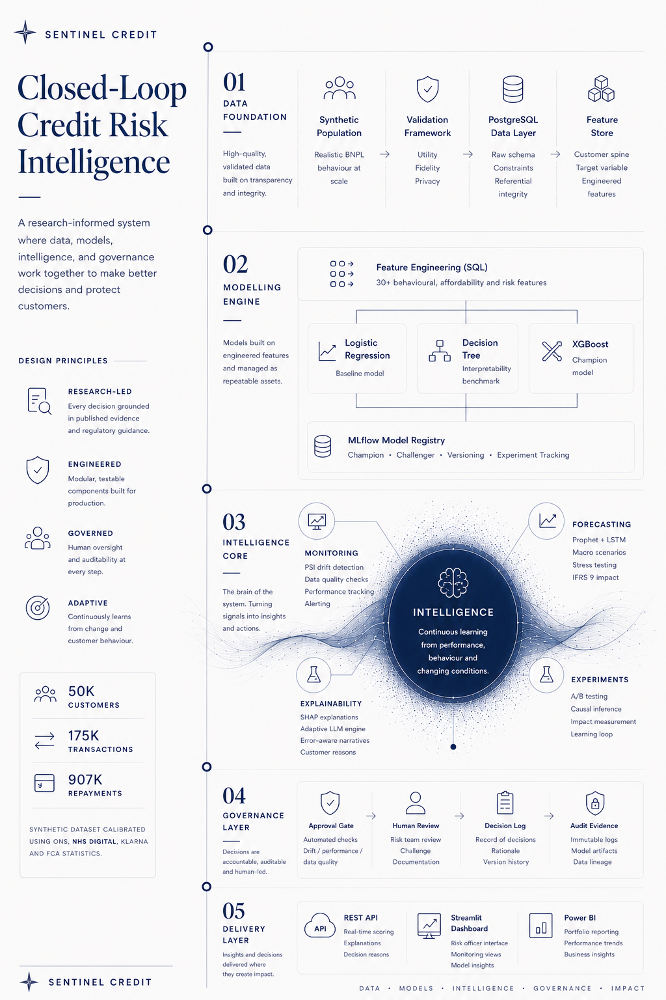

# Sentinel Credit

**A research-informed production architecture demonstrating how synthetic data, explainability, monitoring, and governance can be connected into a closed-loop credit risk workflow for Buy Now, Pay Later (BNPL) lending.**

Every major engineering decision is linked to published research or regulatory guidance and documented in the accompanying Engineering Decision Log.

---

## Architecture



---

## Why

Sentinel Credit explores how a modern credit risk system can be designed for regulated lending environments.

Rather than treating machine learning as a modelling exercise alone, the project treats **governance, explainability, monitoring, auditability, and deployment** as first-class engineering problems.

BNPL was chosen as the application context because it commonly serves customers with limited traditional credit histories, making **governance, explainability, and responsible model deployment** particularly important.

Read more in the [Project Rationale](docs/project_rationale.md).

---

## Repository Philosophy

Sentinel Credit is built as a production-oriented engineering project rather than a collection of disconnected machine learning experiments.

Each completed component solves a specific engineering problem, with the reasoning, implementation, and lessons documented alongside the code.

The goal is not simply to build accurate models, but to demonstrate how modern credit risk systems can be designed, governed, monitored, explained, and deployed as connected workflows.

---

## Implementation Progress

Status as of October 2026, checked against the code. ✅ built and
verified · 🟡 partly built · ⬜ planned, not started. Decision numbers
refer to the [Engineering Decision Log](docs/engineering_decision_log.md).

| Component | What exists | Status |
|---|---|---|
| Synthetic data generator | 50k customers · 174k transactions · 484k repayments · hazard-based, emergent default (D1, D10) | ✅ |
| Validation module | Fidelity 8/8 · Utility PASS · Privacy 2/2 (D2). CTGAN benchmark planned | ✅ |
| Database and feature store | Local PostgreSQL, constrained raw schema, 64-column feature store (D3, D12, D17) | ✅ |
| Three-model benchmarking | Logistic Regression · Decision Tree · XGBoost, calibrated, MLflow-tracked (D4, D13) | ✅ |
| Champion model | **v1.1**: XGBoost, 13 features, cutoff 0.0657 (D18, D19, D27) | ✅ |
| Explainability (SHAP) | Global and local SHAP on the champion (D14) | ✅ |
| A/B test analysis | Two-proportion test, power analysis, covariate balance (D15, D16) | ✅ |
| Champion / Challenger workflow | MLflow Model Registry aliases, validity-override path, rollback rule (D21, D27) | ✅ |
| Drift monitoring | PSI + data quality, origination-cohort view; Airflow, runs while the local stack is up (D20, D24, D25) | ✅ |
| Approval gate | Automated evidence gate on promotion + typed human confirmation; no approver identity recorded (D23) | 🟡 |
| Portfolio forecasting | Prophet, backtested. LSTM and IFRS 9 macro scenarios planned (D22) | 🟡 |
| Scoring API | FastAPI, runs locally (`serving/app.py`) | ✅ |
| Streamlit dashboard | Risk officer interface (`dashboard/`) | ✅ |
| Power BI report | DirectQuery against local PostgreSQL (`dashboard/powerbi/`) | ✅ |
| Adaptive explanation engine | Audience-aware explanations (D7) | ⬜ |
| Deployment / AWS | BentoML · Docker · AWS RDS. Nothing is deployed; everything runs locally (D3, D6) | ⬜ |

---

## Data Foundation

The synthetic dataset was built specifically for this project because no publicly available dataset was identified that adequately represents UK BNPL customer behaviour.

Default is modelled as an emergent outcome of a repayment hazard process, reaching the CRR/EBA 90-days-past-due definition through actual delinquency behaviour, rather than being assigned to a transaction in advance. This keeps repayment history usable as a genuine predictive signal rather than a byproduct of the label.

Generation separates three distinct concepts:

- Published evidence
- Calibrated values
- Documented engineering assumptions

so the origin and justification of every generated value remain explicit.

Validation follows the **FCA, ICO and Alan Turing Institute** framework across:

- Fidelity
- Utility
- Privacy

Loading the data into PostgreSQL exposed an identifier collision that Python validation had not detected, leading to a redesign of the identifier strategy and reinforcing the importance of database-level integrity constraints.

Generator-only variables remain in the raw layer for auditability but are excluded from the feature store to prevent label leakage.

Read more in [Database Design](docs/database_design.md) and [Engineering Decision Log](docs/engineering_decision_log.md).

---

## Engineering Lessons

Several engineering decisions proved more valuable than expected during the project.

- Generating synthetic data is easier than demonstrating that it is fit for purpose.
- Well-designed database constraints uncovered an integrity issue that notebook validation missed.
- Feature engineering is more reliable when performed close to the data.
- A label assigned before the behaviour that should predict it produces features that cannot be trusted, however plausible the individual values look.
- Governance is easier to maintain when it is designed into the architecture from the beginning rather than added afterwards.

---

## Research Foundation

The architecture is informed by published research including:

- FCA Credit Rating Agencies Multi-Firm Review (May 2026)
- Belton et al., FCA AI Explainability Research Note (February 2025)
- FCA / ICO / Alan Turing Institute Synthetic Data Framework (2023)
- PRA SS1/23 Model Risk Management
- CRR/EBA Default Definition and IFRS 9 Significant Increase in Credit Risk

Further documentation:

- [Project Rationale](docs/project_rationale.md)
- [Engineering Decision Log](docs/engineering_decision_log.md)
- [Database Design](docs/database_design.md)
- [References](docs/references.md)

---

## Technology Stack

| Layer | In use | Planned |
|---|---|---|
| Data | Python · PostgreSQL (local) | AWS RDS · S3 |
| Machine Learning | Scikit-learn · XGBoost · SHAP · Prophet | LSTM |
| MLOps | MLflow (tracking + Model Registry) · Apache Airflow (Astro, Docker) | CI checks |
| Serving | FastAPI (local) | Docker image · AWS hosting |
| Visualisation | Streamlit · Plotly · Power BI | — |
| AI | — | Audience-aware explanation layer (D7) |

---

## Getting Started

Generate the synthetic dataset.

```bash
python data_generator/bnpl_data_generator.py
```

Validate the generated dataset.

```bash
python validation/validation.py
```

Create the PostgreSQL schema.

```bash
psql -U postgres -d sentinel_credit -f sql/01_create_schema.sql
```

Project configuration is centralised in:

```text
config.yaml
```

Run the risk-officer dashboard (from the project root, with
`SENTINEL_DB_PASSWORD` set in the environment):

```bash
streamlit run dashboard/Home.py
```

Run the scoring API:

```bash
uvicorn serving.app:app --reload
```

The dashboard's Credit Risk Assessment page and the API share one
feature-construction module (`serving/features.py`), so they score an
applicant identically (Decision 28).

---

## Documentation

| Document | Purpose |
|---|---|
| [Project Rationale](docs/project_rationale.md) | Why the project exists, plus research and regulatory foundations (calibration assumptions, regulatory source mapping) |
| [Engineering Decision Log](docs/engineering_decision_log.md) | Record of consequential engineering decisions, their evidence and outcomes |
| [Database Design](docs/database_design.md) | Schema, integrity constraints, and feature engineering |
| [Validation Results](docs/validation_results.md) | Synthetic-data validation results and methodology |
| [Model Evaluation Report](docs/model_evaluation_report.md) | Model evaluation results and metric definitions |
| [Audit Findings](docs/audit_findings_2026-10-12.md) | October 2026 audit of the documentation against the code |
| [Power BI Setup](dashboard/powerbi/README.md) | How the Power BI report connects to the reporting views |
| [References](docs/references.md) | Regulatory publications, academic research, and calibration sources |

Some narrative reports (SHAP explainability, training summary, feature
governance) still describe the August 2026 v1 champion. The live v1.1
evidence is regenerated under `reports/`; see Decision 27.

---

## Current Status

The modelling, monitoring and governance loop runs end to end on a local stack. The live champion is **v1.1**, a calibrated XGBoost on 13 features. It was promoted in October 2026 after `pct_late_payments` was removed for leaking outcome information (Decision 27). Drift monitoring and the approval gate run under Airflow while the local stack is up, and a Power BI badge shows STALE when monitoring evidence lapses. Nothing is deployed to the cloud yet. Open items are tracked in the [Audit Findings](docs/audit_findings_2026-10-12.md).

Follow the build on LinkedIn:

**Folarin Korede**

---

## Disclaimer

Sentinel Credit is an independent portfolio project informed by publicly available research and regulatory publications.

References to the FCA, PRA, ICO, Alan Turing Institute, and other organisations indicate publications that informed engineering decisions. They should not be interpreted as evidence of regulatory approval, certification, endorsement, or affiliation with the project.
