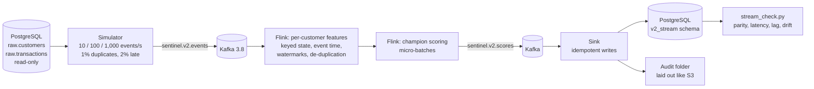

# Sentinel Credit v2, Phase 4: streaming credit decisions (PyFlink)

**What this is.** The v1 synthetic BNPL history replayed as a live event stream. Kafka carries
customer registrations and applications; a PyFlink job keeps every customer's features up to
date and scores each application with the unchanged v1.1 champion.

**What it is not.** It is a simulated stream of synthetic data, not real customers or live
traffic. It runs in **shadow mode**: decisions are logged and never returned to anyone. The v1
API stays the system of record. Full reasoning and results: **V2-03** in the
[v2 Engineering Decision Log](../../docs/v2_engineering_decision_log.md).



## Results (real runs, 30th October 2026)

| Rate | Events (customers) | Every event once, every duplicate dropped | Customers matching v1 | Send → processed p50 / p99 |
|---|---:|---|---:|---|
| 10/s | 1,803 (400) | Yes | 400 / 400 | 3.1 s / 6.2 s |
| 100/s | 17,872 (4,000) | Yes | 4,000 / 4,000 | 4.3 s / 7.8 s |
| 1,000/s | 224,421 (50,000) | Yes | 50,000 / 50,000 | Fell behind: about 360/s sustained, caught up without loss |

- **Failure test:** a killed Flink TaskManager (restored from checkpoint) and a killed sink,
  with no loss and no double counting.
- **Scores:** within 1.0e-8 of the champion on the host, with no decision different.
- **How the design was reached:** the failed runs and throughput experiments, and the
  limits, are in V2-03.

## Files

| File | What it does |
|---|---|
| `stream_features.py` | The per-customer state and the 13 features, matching `sql/02_feature_store.sql` exactly (pure Python, unit-tested) |
| `flink_job.py` | The PyFlink job: per-customer keyed state, event-time lateness, duplicate handling, micro-batched scoring, checkpoints |
| `simulator.py` | Replays chosen customers' histories into Kafka at a fixed rate, with duplicates, late events, watermark heartbeats and lag sampling; also the replay agent used by Airflow |
| `sink.py` | Stores results in `v2_stream` and the audit folder, idempotently |
| `stream_check.py` | Checks one run: completeness, parity with the v1 feature store, latency, throughput, lag, scoring parity, drift, Approval Gate status |
| `docker-compose.yml`, `flink.Dockerfile`, `tools.Dockerfile`, `flink-conf/config.yaml` | The local stack |
| `stream.ps1` | Start, submit, replay, status, stop, teardown |
| `../sql/phase4_stream.sql` | The `v2_stream` schema |
| `../../infra/dags/sentinel_v2_stream_replay.py` | Airflow DAG: request a replay, wait, check it |
| `../../tests/test_v2_stream.py` | Unit tests of the feature state |

## Run it (Windows PowerShell)

The v1 PostgreSQL database must be running, and `SENTINEL_DB_PASSWORD` set in your shell.

```powershell
.\v2\streaming\stream.ps1 start            # Kafka, Flink, sink, replay agent; topics and schema
.\v2\streaming\stream.ps1 submit           # the PyFlink job
.\v2\streaming\stream.ps1 replay -Rate 100 -Customers 4000
.\v2\streaming\stream.ps1 status
.\v2\streaming\stream.ps1 stop             # keeps everything; start again to resume
.\v2\streaming\stream.ps1 teardown         # removes containers, Kafka data and checkpoints
```

The Flink web UI is at http://127.0.0.1:8081 while the stack runs. A replay with the default
settings takes the stream time plus up to 10 minutes, because 2% of events are delivered up
to 10 minutes late on purpose.
